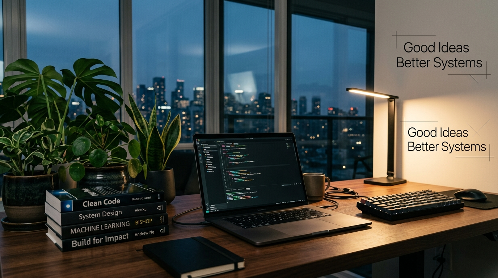

  <!-- ======================================================== -->
  <!-- 1. HERO BANNER                                           -->
  <!-- ======================================================== -->
  
    
  <!-- ======================================================== -->
  <!-- 2. ANIMATED TYPING TAGLINE                               -->
  <!-- ======================================================== -->
  

 
---
## My favorite tools and technologies ⚙️
> Tools and technologies that I have worked with and am interested in

<table align="center">
  <!-- Row 1: Core Languages & Frontend -->
  <tr>
    <td align="center" width="96">
      
       Python
    </td>
    <td align="center" width="96">
      
       TypeScript
    </td>
    <td align="center" width="96">
      
       JavaScript
    </td>
    <td align="center" width="96">
      
       C++
    </td>
    <td align="center" width="96">
      
       Java
    </td>
    <td align="center" width="96">
      
       React
    </td>
    <td align="center" width="96">
      
       HTML
    </td>
    <td align="center" width="96">
      
       CSS
    </td>
    <td align="center" width="96">
      
       Tailwind
    </td>
  </tr>
  <!-- Row 2: AI / ML & Backend -->
  <tr>
    <td align="center" width="96">
      
       PyTorch
    </td>
    <td align="center" width="96">
      
       TensorFlow
    </td>
    <td align="center" width="96">
      
       OpenCV
    </td>
    <td align="center" width="96">
      
       Scikit-Learn
    </td>
    <td align="center" width="96">
      
       FastAPI
    </td>
    <td align="center" width="96">
      
       Flask
    </td>
    <td align="center" width="96">
      
       REST API
    </td>
    <td align="center" width="96">
      
       Nginx
    </td>
    <td align="center" width="96">
      
       Linux
    </td>
  </tr>
  <!-- Row 3: Databases & DevOps / Cloud -->
  <tr>
    <td align="center" width="96">
      
       PostgreSQL
    </td>
    <td align="center" width="96">
      
       MongoDB
    </td>
    <td align="center" width="96">
      
       MySQL
    </td>
    <td align="center" width="96">
      
       Redis
    </td>
    <td align="center" width="96">
      
       Firebase
    </td>
    <td align="center" width="96">
      
       Docker
    </td>
    <td align="center" width="96">
      
       Git
    </td>
    <td align="center" width="96">
      
       GitHub
    </td>
    <td align="center" width="96">
      
       Postman
    </td>
  </tr>
</table>

 
---

 

  <i>“ Build things that solve real problems, not just look good. ”</i>

